<picture><source media="(prefers-color-scheme: dark) and (max-width: 600px)" srcset="assets/conversa-m-dark.svg"><source media="(prefers-color-scheme: dark)" srcset="assets/conversa-dark.svg"><source media="(max-width: 600px)" srcset="assets/conversa-m.svg"></picture>

<a href="https://github.com/Rafael-CN/harmony"><picture><source media="(prefers-color-scheme: dark) and (max-width: 600px)" srcset="assets/harmony-m-dark.svg"><source media="(prefers-color-scheme: dark)" srcset="assets/harmony-dark.svg"><source media="(max-width: 600px)" srcset="assets/harmony-m.svg"></picture></a>
<a href="https://github.com/Rafael-CN/nexo"><picture><source media="(prefers-color-scheme: dark) and (max-width: 600px)" srcset="assets/nexo-m-dark.svg"><source media="(prefers-color-scheme: dark)" srcset="assets/nexo-dark.svg"><source media="(max-width: 600px)" srcset="assets/nexo-m.svg"></picture></a>
<a href="https://github.com/Rafael-CN/habito"><picture><source media="(prefers-color-scheme: dark) and (max-width: 600px)" srcset="assets/habito-m-dark.svg"><source media="(prefers-color-scheme: dark)" srcset="assets/habito-dark.svg"><source media="(max-width: 600px)" srcset="assets/habito-m.svg"></picture></a>
<a href="https://github.com/Rafael-CN/vibe-artemis"><picture><source media="(prefers-color-scheme: dark) and (max-width: 600px)" srcset="assets/vibe-artemis-m-dark.svg"><source media="(prefers-color-scheme: dark)" srcset="assets/vibe-artemis-dark.svg"><source media="(max-width: 600px)" srcset="assets/vibe-artemis-m.svg"></picture></a>
<a href="https://github.com/Rafael-CN/minecraft-bedrock"><picture><source media="(prefers-color-scheme: dark) and (max-width: 600px)" srcset="assets/minecraft-bedrock-m-dark.svg"><source media="(prefers-color-scheme: dark)" srcset="assets/minecraft-bedrock-dark.svg"><source media="(max-width: 600px)" srcset="assets/minecraft-bedrock-m.svg"></picture></a>

<picture><source media="(prefers-color-scheme: dark) and (max-width: 600px)" srcset="assets/digitando-m-dark.svg"><source media="(prefers-color-scheme: dark)" srcset="assets/digitando-dark.svg"><source media="(max-width: 600px)" srcset="assets/digitando-m.svg"></picture>

A sua vez: me chama no [LinkedIn](https://www.linkedin.com/in/rafael-y/) ou em rcn.ytay@gmail.com.
